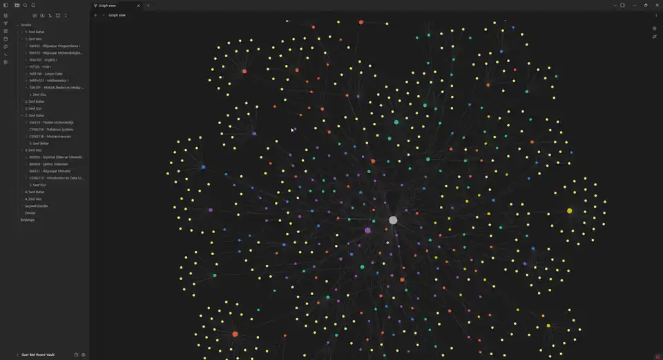

# gazi-bm-mf-notlar

Gazi Üniversitesi Bilgisayar Mühendisliği ders kaynakları deposu: çıkmış sorular ve çözümleri, ders notları
(öğrenci el notları dahil), slaytlar ve sınıf sohbetlerinden derlenen sınav bilgileri. Hepsi ders koduna göre
düzenli, her dosyanın bir metadata kaydı var. Depoyu AI agent'ları yönetiyor, kararsız kalınan her şeyi bir insan onaylıyor.

*Course resource archive for Gazi University Computer Engineering, managed by AI agents with human review.
Agents: start with [`AGENTS.md`](AGENTS.md).*

## İndir ve kur (2 dakika)


1. **[Releases sayfasını aç](https://github.com/isobed18/gazi-bm-mf-notlar/releases/latest)** → *Assets* altındaki
   **`Gazi-BM-Vault.zip`** dosyasını indir (~1.5 GB). Drive, git veya hesap gerekmez.
2. Zip'i bir klasöre çıkar.
3. [Obsidian](https://obsidian.md)'ı aç → *Open folder as vault* → o klasörü seç. `Başlangıç` notundan başla.

Agent'ına "indir kur" demen de yeter: adımlar [INSTALL.md](INSTALL.md) içinde. Yeni sürüm çıkınca aynı şekilde
indirip klasörü değiştir.
Dosya göndermek için: [Kaynak Gönder formu](https://docs.google.com/forms/d/e/1FAIpQLSccuOWOSr4S9dCxMROm2lOoa0IgOjIznh9X3YZ1ieTljdW9Ng/viewform).

## Güncellemeler
- **10.11.2026**: sohbet gruplarındaki fotoğraf ve belgeler baştan tarandı, 69 yeni kaynak eklendi (toplam 650).
  Yeni sınavlar: İSG401, PHYS104, CENG206, MAT102, ENG204, FIZ103, CENG316; BM222 ve CENG483 çözümleri; birçok ders
  için harf notu dağılımları ve öğrenci notları. Ödevler artık her dersin "Ödevler ve Quizler" sayfasında.
- **09.11.2026**: ilk sürüm.

## Yapı
```
catalog/            müfredat (curriculum.yaml), kaynak türleri (taxonomy.yaml), index.json
courses/<KOD>/      exams/ exam-solutions/ lecture-notes/ student-notes/ slides/ announcements/ …  (+ otomatik README.md)
general/            derse ait olmayan, onaylanmış kaynaklar
tools/              archive.py (tek araç), obsidian_export.py, chatintel.py, weekly.py/.ps1, hooks/
.agents/skills/     agent yönergeleri (İngilizce)
```

## Obsidian vault'u
`archive.py export-obsidian` depodan **dönem yapılı** bir çalışma vault'u üretir:
```
Dersler/
  1. Sınıf Güz/
    BM101 - Bilgisayar Programlama I/
      BM101 Çıkmış Sorular.md      sınavlar + çözümler + sohbetlerden aktarılan sınav bilgileri
      BM101 Ders Notları.md        hoca notları, öğrenci notları, özetler
      BM101 Slaytlar.md
  …
  Seçmeli Dersler/
```
Dönem = müfredattaki yarıyıl (`catalog/curriculum.yaml`).

## Dosyalar nerede? (bakım yapanlar için)
*Sadece kullanmak istiyorsan bu bölümü atla, yukarıdaki zip yeterli.*
Git'te sadece metadata, notlar ve araçlar var. **Dosyaların kendisi (PDF, slayt, fotoğraf) Google Drive aynasında**,
klasör yapısı depoyla aynı. Ayrıntılar: [docs/STORAGE.md](docs/STORAGE.md).

| Sürüm | İçerik | Nasıl |
|---|---|---|
| **full** | her şey | Drive klasörünün tamamı veya `archive.py storage-pull` |
| **core** | öğrenci notları hariç | `student-notes/` klasörlerini atla veya `archive.py storage-pull --variant core` |

## Kurulum (bakım yapan makine)
```bash
pip install -r tools/requirements.txt
cp config.example.yaml local/config.yaml      # vault yolu, Drive remote'u, gelen kutusu klasörleri
git config core.hooksPath tools/hooks          # commit öncesi gizlilik/secret denetimi
powershell -File tools/install-weekly-task.ps1 # haftalık bakım (Pazar 21:00; bilgisayar kapalıysa açılınca)
```

## Haftalık bakım
`tools/weekly.ps1`: issue'lardaki kararları uygular, gelen kutularındaki ve issue'lardaki yeni dosyaları
tarar (Windows Defender / ClamAV, tür ve makro kontrolü), doğru derse yerleştirir, doğrulanmamış kaynakları
kontrol eder, vault'u üretir, denetimden geçerse commit'ler. Agent: agy (Gemini). Ayrıntılar:
`.agents/skills/weekly-maintenance/SKILL.md`.

## Katkı
[CONTRIBUTING.md](CONTRIBUTING.md). Kısaca: dosyaları **[Gazi BM Kaynak Gönder formu](https://docs.google.com/forms/d/e/1FAIpQLSccuOWOSr4S9dCxMROm2lOoa0IgOjIznh9X3YZ1ieTljdW9Ng/viewform)** ile gönder
(her gönderim tek ders + tek tür; dosyaları AI agent'ına sınıflandırtman önerilir). Depo agent'ı inceler, bir insan onaylar.

## Gizlilik ve güvenlik
Sohbet metinleri, telefon numaraları, kişisel fotoğraflar ve kişisel notlar depoya **girmez**; commit öncesi ve
CI'da `archive.py audit` bunu denetler. Ayrıntılar: [docs/SECURITY.md](docs/SECURITY.md).
